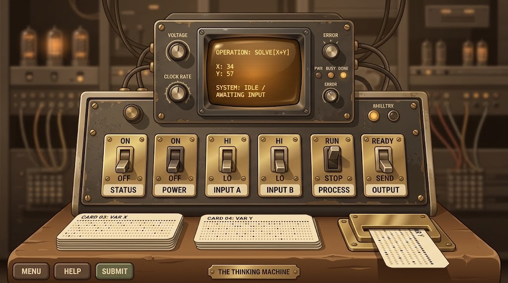
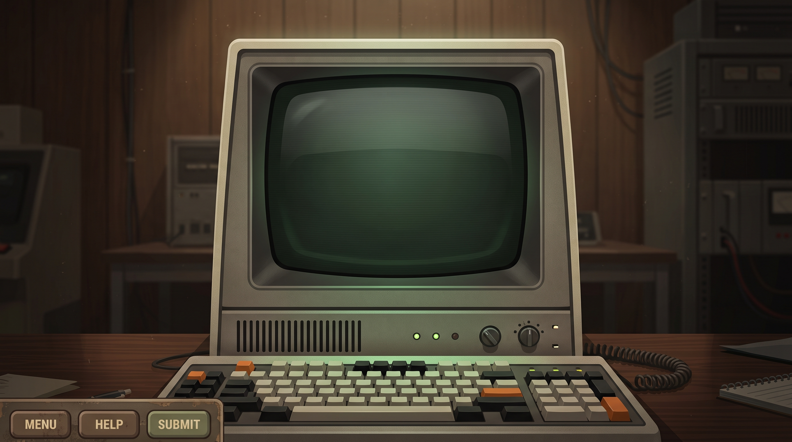
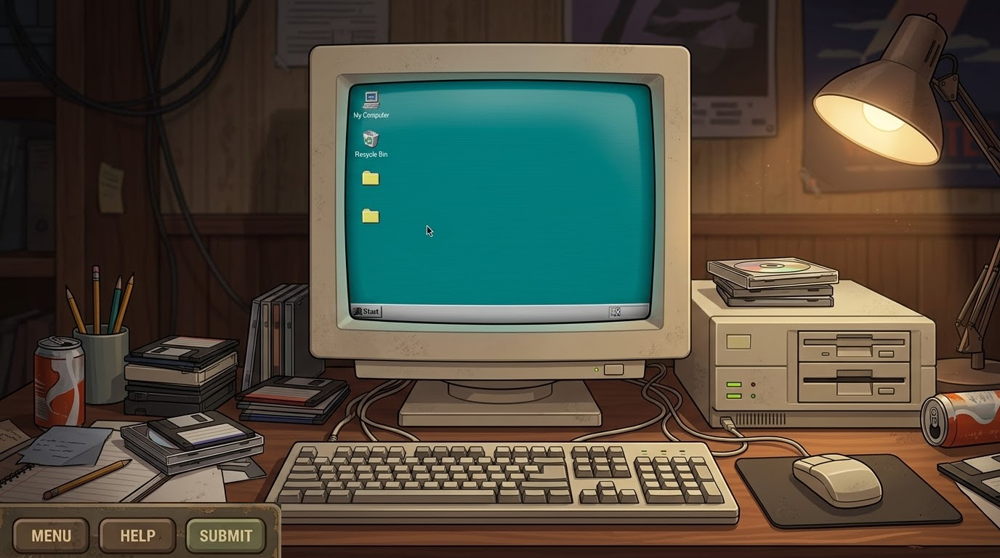
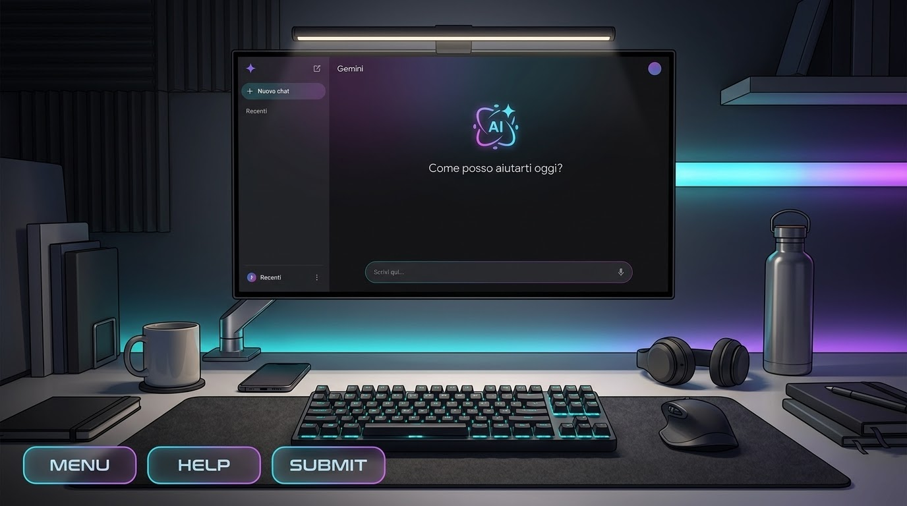

# Chrono-Compile


Chrono-Compile is an educational puzzle game developed as part of a Master's
thesis in Computer Science at the University of Camerino. The project examines
how the historical development of programming paradigms can be presented
through an interactive learning environment, with particular attention to
cognitive load during the acquisition of programming concepts.

The game presents four stages of computing history. Each stage uses a
different interaction model and focuses on a specific transition in the
relationship between programmers, programs, and machines.

## Game Structure

| Scene | Historical context | Main activity |
| --- | --- | --- |
| `LV1` | 1940s: Von Neumann architecture | Operating a simulated computer through power, input, processing, output, and execution controls |
| `LV2` | 1960s-1970s: Structured programming | Rewriting programs based on line numbers, `GOTO`, conditional execution, and loops |
| `LV3` | 1990s: Virtual machines and visual programming | Assembling code blocks, compiling a program, and selecting a compatible target platform |
| `LV4` | 2020s: Artificial intelligence and prompt engineering | Writing prompts that specify operations, error handling, and bounded iteration |
| `Fine` | Final assessment | Reviewing game statistics and achievements, with access to the thesis questionnaire |

Each level contains three progressively more demanding tasks. Contextual help,
explicit objectives, terminal output, error messages, and debriefing text are
used to support the learning process without removing the problem-solving
component.

## Level Environments

The visual design of each level reflects its historical setting and
interaction model.

### LV1 — Early Computing



### LV2 — Structured Programming



### LV3 — Virtual Machines and Visual Programming



### LV4 — Artificial Intelligence and Prompt Engineering



## Educational Framework

Chrono-Compile applies game-based learning to introductory programming
education. Its progression moves from direct machine control to increasingly
abstract forms of programming:

1. execution of operations through hardware-like controls;
2. control flow and the limitations of unstructured code;
3. abstraction, compilation, scope, and platform compatibility;
4. specification and error handling through natural-language prompts.

The design is informed by the cognitive load model described by Leppink. The
interface provides structured objectives and immediate feedback to limit
unnecessary cognitive demands, while the tasks retain the intrinsic difficulty
of sequencing, control flow, scope, platform constraints, and edge cases.

The final scene records the results of the session and provides a link to the
questionnaire used for the empirical component of the thesis.

## Use of AI During Development

AI-assisted tools were used as a practical part of the development process.
Their use was motivated by the limited development time, the available budget,
and the difficulty of finding suitable assets online for some historical
settings. AI supported code prototyping, iteration, and the creation or
adaptation of visual assets when appropriate alternatives were not available.

The final selection of assets, integration in Unity, gameplay logic, level
design, and evaluation-related decisions remained part of the project
development process. AI assistance was therefore used to address practical
resource constraints, rather than as a replacement for the design and
implementation work.

## Main Features

- Four chronological programming scenarios with different interaction models.
- Three difficulty stages in each level.
- Contextual help panels and objective prompts.
- Terminal-style output, typewriter text, generated code previews, and
  simulated AI chat.
- Scene transitions, period introductions, fade effects, button animations,
  and screen-shake feedback.
- Session statistics, including elapsed time, errors, and help usage.
- Per-stage, per-level, timed, and global achievements.
- Final report with a summary of statistics and unlocked achievements.
- Menu navigation for starting a new session, selecting levels, reviewing
  achievements, opening the thesis questionnaire, and exiting the application.

## Requirements

- Unity **6000.3.23f1** (Unity 6)
- Unity Hub
- Git
- An operating system supported by the selected Unity version

The project uses Unity Input System, TextMesh Pro, UGUI, Timeline, Visual
Scripting, Unity AI Assistant, and Unity AI Inference. Package versions are
specified in [`Packages/manifest.json`](Packages/manifest.json).

## Getting Started

Clone the repository and open it with the required Unity version:

```bash
git clone https://github.com/iamShallo/Chrono-Compile.git
cd Chrono-Compile
```

Open the project through Unity Hub, then open the `Menu` scene and enter Play
Mode. The scenes used by the game are listed in
[`ProjectSettings/EditorBuildSettings.asset`](ProjectSettings/EditorBuildSettings.asset):

```text
Menu -> LV1 -> LV2 -> LV3 -> LV4 -> Fine
```

To create a build, confirm that these scenes are included in the build
configuration and appear in the order shown above. The `Library/` directory is
generated by Unity and is not required when cloning or restoring the project.

## Repository Layout

```text
Chrono-Compile/
├── Assets/
│   ├── Scenes/
│   │   ├── Menù/
│   │   │   ├── Menu.unity
│   │   │   └── Script/
│   │   │       ├── AchievementMenu.cs
│   │   │       ├── BottoneAnimato.cs
│   │   │       └── MenuManager.cs
│   │   ├── LV1/
│   │   │   ├── LV1.unity
│   │   │   └── Script/Livello1Manager.cs
│   │   ├── LV2/
│   │   │   ├── LV2.unity
│   │   │   └── Script/Livello2Manager.cs
│   │   ├── LV3/
│   │   │   ├── LV3.unity
│   │   │   └── Script/Livello3Manager.cs
│   │   ├── LV4/
│   │   │   ├── LV4.unity
│   │   │   └── Script/Livello4Manager.cs
│   │   └── Fine/
│   │       ├── Fine.unity
│   │       ├── GameAnalytics.cs
│   │       └── Livello5Manager.cs
├── Packages/
├── ProjectSettings/
└── README.md
```

### Core Scripts

- `MenuManager` controls scene navigation, level selection, loading fades,
  achievements, and external links.
- `Livello1Manager` through `Livello4Manager` implement the level-specific
  tasks, user interface, help system, feedback, and transitions.
- `GameAnalytics` maintains session statistics, achievement state, and the
  final reports.
- `Livello5Manager` presents the final report and handles the return to the
  main menu.
- `AchievementNotification` displays achievements when they are unlocked
  during a level.

## Project Status

The repository contains a playable Unity prototype covering the complete
sequence from the main menu to the final scene. The questionnaire link is
included in the application for the thesis data-collection phase. Empirical
analysis of the collected responses is outside the runtime project.

## License

The repository does not currently include a license file. A license should be
added before distributing the project outside its thesis context.
